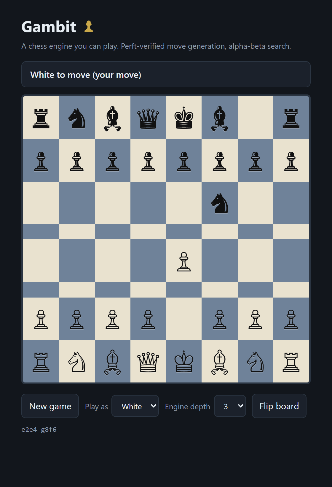

# Gambit ♟

[](https://github.com/BoogeyCodes/gambit/actions/workflows/ci.yml)


A chess engine you can play, in the browser. Gambit has a from-scratch move generator (validated
with **perft** against the published node counts), an alpha-beta search that actually plays, and a
click-to-move board — all in dependency-free TypeScript.



## Why it's interesting

Chess move generation is deceptively hard: castling rights, en passant, promotion, pins, and the rule
that you may not leave your own king in check all interact. The standard way to prove a generator is
correct is **perft** — count the leaf nodes of the move tree to depth *n* from a known position and
compare against the published numbers. Gambit matches them exactly:

| Position | depth | nodes |
| --- | --- | --- |
| Start | 4 | 197,281 |
| [Kiwipete](https://www.chessprogramming.org/Perft_Results) | 3 | 97,862 |
| Position 3 | 4 | 43,238 |
| Position 5 | 3 | 62,379 |

If any rule were wrong — a missing en-passant, a castle through check, a bad pin — these counts would
not line up. They do.

## How it works

```
src/engine
├── board.ts      0..63 board, pieces, FEN parse/format
├── attacks.ts    square-attack detection (the basis of "is the king in check?")
├── movegen.ts    pseudo-legal generation, make/unmake, and the legal filter
├── perft.ts      the correctness oracle (+ perft-divide for debugging)
├── search.ts     material + piece-square evaluation, alpha-beta (negamax)
└── notation.ts   UCI move strings
src/main.ts       the click-to-play board UI
```

- **Legal moves** are generated by producing pseudo-legal moves, playing each on the board, and
  keeping only those that don't leave the mover's king attacked (`make` / `unmake`, so there's no
  board copying in the hot path).
- **Search** is negamax with alpha-beta pruning and a cheap capture-first move ordering, over a
  material + piece-square-table evaluation. It finds forced mates and plays reasonable moves.

## Play it

```bash
npm install
npm run dev        # http://localhost:5173
```

Pick your colour and the engine's search depth, click a piece to see its legal moves, and click a
square to play. The engine replies. (Pawn promotions default to a queen.)

### Build / Docker

```bash
npm run build                         # static bundle in dist/
docker build -t gambit . && docker run --rm -p 8080:80 gambit   # http://localhost:8080
```

## Testing

```bash
npm test
```

Vitest covers the engine end to end: **perft** for four reference positions (the real proof of
move-generation correctness), plus rules tests for checkmate, stalemate, promotion, en passant and
FEN round-tripping, and search tests that the engine finds a back-rank mate in one and always returns
a legal move.

## Tech

TypeScript · Vite · Vitest · zero runtime dependencies · GitHub Actions · Docker (nginx).

## License

MIT
